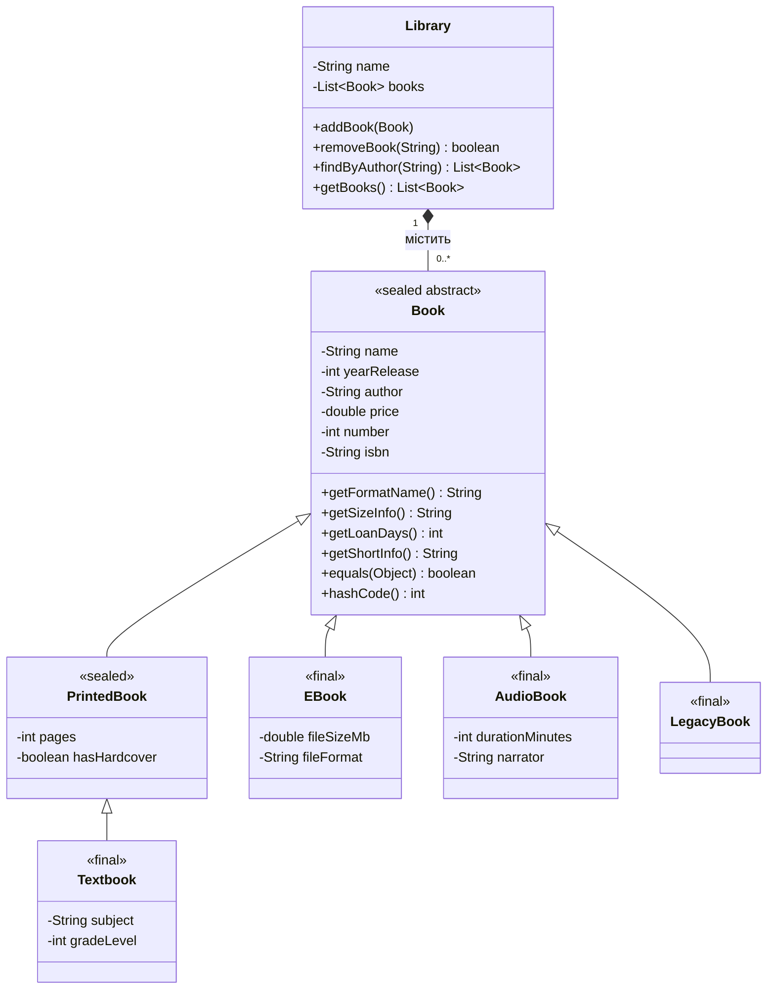

# Лабораторна робота 1 — Консольний застосунок з темою бібліотека (Книжка / Читач)

## Опис сутностей
- **Книжка**: назва, рік випуску, ціна
- **Читач**: ім'я, номер картки, номер телефону

## Обчислювальна операція
Якщо книжка видана 2007 року або раніше — ціна збільшується на 5%.

## Інструкція запуску

javac Main.java
java Main


## Лабораторна робота 2 — Масиви об'єктів (Книжка / Читач)

### Реалізовано
- Клас `Book` (назва, рік випуску, автор, рекомендований вік, ціна) з конструктором і `toString()`
- Клас `Reader` (ім'я, номер картки, телефон, рік народження) з конструктором і `toString()`
- Заповнення масивів `Book[]` та `Reader[]` через консоль (Scanner) у циклі
- Валідація вводу — захист від некоректних значень (рік, вік, ціна, кількість)
- Виведення масивів через for-each
- Підрахунок книжок дешевших за задану суму
- Сортування масиву книжок за ціною методом bubble sort (до/після сортування)
- Лінійний пошук книжки в масиві за повним збігом об'єкта (`equalsBook`)
- Розрахунок знижки 5% для книжок 2007 року видання і старших, з виведенням різниці цін

### Компіляція та запуск
```bash
javac *.java
java Main
```

## Лабораторна робота 3 — Обробка винятків

### Реалізовано
- Обробка стандартних винятків (`InputMismatchException`, `ArrayIndexOutOfBoundsException`, `ArithmeticException`) через конкретні catch-блоки
- `finally` для гарантованого закриття Scanner і фінального повідомлення
- Власний checked-виняток `DomainException` (базовий клас, extends Exception)
- Підкласи `InvalidPriceException` та `InvalidAgeException` з додатковим полем некоректного значення
- Валідація доменних правил безпосередньо в конструкторі `Book` (throw new ...)
- Множинні catch-блоки в одному try, впорядковані від специфічних типів до загальних
- Демонстрація re-throw: метод `createBook()` логує помилку і прокидає її далі
- Демонстрація поліморфізму винятків: один catch(DomainException) перехоплює обидва підтипи

### Компіляція та запуск
```bash
javac *.java
java Main
```

## Лабораторна робота 4 — Реалізація програмних інтерфейсів мовою Java

### Структура проєкту
```
task/java/
├── Main.java                      (головний клас, точка входу)
├── Class/
│   ├── Book.java                  (книга — поля, конструктор, toString, equals)
│   └── Reader.java                (читач — поля, конструктор, toString)
├── Exceptions/
│   ├── DomainException.java       (базовий checked-виняток домену)
│   ├── InvalidAgeException.java   (виняток невірного віку)
│   └── InvalidPriceException.java (виняток невірної ціни)
├── Interfaces/
│   ├── DiscountStrategy.java      (інтерфейс стратегії знижки з default-методом getDescription())
│   ├── RegularDiscount.java       (знижка 5% для книг 2007 року і старше)
│   ├── NewReleaseDiscount.java    (знижка 10% для новинок після 2007 року)
│   ├── FirstLetterMatchDiscount.java (підвищення ціни на 50%, якщо перша буква імені читача збігається з першою буквою назви книги)
│   └── Sortable.java              (інтерфейс сортування за ключем)
├── Abstract/
│   └── AbstractDiscountStrategy.java (абстрактний клас, імплементує DiscountStrategy частково: спільна валідація ціни та року)
└── Context/
    └── DiscountContext.java       (контекстний клас патерну Strategy — приймає стратегію через конструктор, має сетер для зміни в рантаймі, делегує виконання)
```

### Рівень 1 — Базовий (обов'язковий minimum)
- Визначено поведінку, яка відрізняється у різних сутностях: стратегія розрахунку знижки для книги.
- Описано цю поведінку у вигляді інтерфейсу `DiscountStrategy` з методом `applyDiscount(double price, int yearRelease)`.
- Реалізовано дві різні реалізації інтерфейсу: `RegularDiscount` та `NewReleaseDiscount`.
- Продемонстровано поліморфне використання: масив об'єктів типу `DiscountStrategy[]`, виклик методу у циклі, поведінка різна для різних реалізацій.

### Рівень 2 — Середній
- Додано `default`-метод `getDescription()` до інтерфейсу `DiscountStrategy` — успадковується усіма реалізаціями, може бути перевизначений.
- Створено абстрактний клас `AbstractDiscountStrategy`, що імплементує `DiscountStrategy` частково (задає спільну логіку валідації ціни та року, але не реалізує саму формулу знижки). Конкретні класи (`RegularDiscount`, `NewReleaseDiscount`) наслідують його.
- Клас `BookWithSort` реалізує кілька інтерфейсів одночасно: `DiscountStrategy` (бізнес-поведінка) та `Sortable` (сортування за ціною).
- Додано функцію: якщо перша буква імені читача співпадає з першою буквою назви книги — ціна піднімається на 50% (`FirstLetterMatchDiscount`).

### Рівень 3 — Високий (патерн Strategy)
- Створено контекстний клас `DiscountContext`, який приймає інтерфейс-стратегію через конструктор.
- Має сетер `setStrategy(DiscountStrategy)`, що дозволяє змінювати стратегію під час виконання програми (runtime), не створюючи новий об'єкт контексту.
- Метод `executeDiscount(double price, int yearRelease)` делегує виконання поточній стратегії.
- У `Main.java` продемонстровано зміну стратегії в рантаймі: `RegularDiscount` → `NewReleaseDiscount` → `FirstLetterMatchDiscount` на одній і тій ж книзі.

### Лабораторна робота 5 — Рефакторинг з патернами проєктування

#### Рівень 1 — Factory Method

**Проблема:** об'єкти стратегій знижок створювалися прямими викликами `new` у кількох місцях `Main.java`. Додавання нового типу знижки вимагало правки кожного такого місця.

**Рішення:** винесено логіку створення в клас-фабрику `Factory.DiscountFactory`:
- `createDiscount(String type)` — повертає `DiscountStrategy` за кодом типу (`REGULAR`, `NEW_RELEASE`, `FIRST_LETTER`).
- `createFirstLetterDiscount(String readerName)` — створює стратегію для конкретного читача.
- Усі прямий `new` у `Main.java` замінено на виклики фабрики.

Тепер додавання нового типу знижки вимагає правки лише в одному місці — у `DiscountFactory`.

#### Рівень 2 — Observer + JSON-логування

**Проблема:** зміна стану книги (ціни, кількості, статусу) повинна сповіщати інші частини системи (консольний лог, файл логів).

**Рішення:** реалізовано патерн Observer:
- Інтерфейс `Observer.LibraryObserver` з методом `update(String event, Object source)`.
- Клас-суб'єкт `Observer.LibrarySubject` зі списком підписників і методом `notifyObservers`.
- Два спостерігачі: `ConsoleLoggerObserver` (вивід у консоль) і `FileJsonLoggerObserver` (запис у JSON).
- Клас `Controller.LogController` керує записом у файл `Logs/LogJava.json`:
  - створює папку `Logs/` при потребі;
  - якщо файл `LogJava.json` вже існує — дописує нові записи;
  - кожен запис містить: `timestamp`, `event`, `bookName`, `oldPrice`, `newPrice`, `oldNumber`, `newNumber`, `oldStatus`, `newStatus`.

**Додаткові поля у `Book`:** `status` (В наявності / Закінчився), `number` (кількість екземплярів), `isbn`, `genre`, `publisher`, `rating` (0.0–5.0). Статус оновлюється автоматично при зміні кількості.

**Додаткові поля у `Reader`:** `email`, `registrationDate`, `isActive`.

**Валідація (клас `Exceptions.Validator`):**
- Телефон: має містити принаймні 7 цифр, дозволені символи `+`, `-`, `(`, `)`, пробіли.
- Email: має містити `@`, точку після `@`, не починатися ani не закінчуватися на `@` або `.`.

У `Main.java` додано цикли повторного введення для телефону та email, якщо формат невірний.

#### Рівень 3 — Adapter (Високий)

**Проблема:** у нас є ззовнішній/застарілий клас `Legacy.LegacyBookCatalog` із власними методами (`addLegacyBook`, `getLegacyCost`, `listAllLegacyTitles`), які не відповідають інтерфейсу, очікуваному нашим кодом (`BookCatalog`). Ми не можемо змінювати цей клас, бо це "зовнішня бібліотека".

**Рішення:** реалізовано патерн Adapter:
- Клас `Adapter.LegacyBookCatalogAdapter implements BookCatalog` огортає `LegacyBookCatalog` і перекладає виклики:
  - `addBook(Book)` → `addLegacyBook(title, year, cost)`
  - `getPrice(String)` → `getLegacyCost(String)`
  - `getAllBooks()` → перетворює `String[]` з `listAllLegacyTitles()` у `List<Book>`
- Сам `LegacyBookCatalog` не змінювався.

**Чому саме Adapter, а не переписування класу:**
- Клас належить сторонній бібліотеці — немає доступу до вихідного коду або це порушить інкапсуляцію.
- Переписування вимагало б змін у всіх місцях, де цей клас вже використовується зі своїм старим API.
- Адаптер дозволяє використовувати ззовнішній клас через зручний для нас інтерфейс без змін у самому класі.

#### Компіляція та запуск
```bash
javac Main.java Class/*.java Exceptions/*.java Abstract/*.java Interfaces/*.java Context/*.java Factory/*.java Observer/*.java Controller/*.java Legacy/*.java Adapter/*.java
java Main
```


### Рівень 3 — Високий

**equals/hashCode і симетрія.** `Book`, `PrintedBook`, `Textbook`, `EBook`, `AudioBook`
перевизначають `equals()` і `hashCode()`; кожен підклас порівнює свої нові поля після
`super.equals(...)`. Демонстрація (пункт меню 16):

| Вираз | `getClass()` (наш варіант) | `instanceof` (наївний варіант) |
|---|---|---|
| `base.equals(sub)` | `false` | `true` |
| `sub.equals(base)` | `false` | `false` |
| Симетрія | збережена | **порушена** |

Підхід `instanceof` у базовому класі вважає підклас «таким самим» об'єктом, а підклас, який
додав поле й вимагає його збігу, відповідає `false` у зворотний бік. Якщо ж підклас
пом'якшити й порівнювати лише базові поля з базовим об'єктом, зламається транзитивність
(`a.equals(b)`, `b.equals(c)`, але `!a.equals(c)`). Також порушується контракт `hashCode`:
рівні об'єкти мають різні хеші. Я обрав `getClass()`: підкласи додають стан, тому об'єкти
різних класів не повинні вважатися рівними, і всі властивості контракту виконуються. Ціна
такого вибору: порушується принцип підстановки Лісков для `equals` (екземпляр анонімного
підкласу не дорівнює екземпляру батька). Для кінцевих `final`-класів (`EBook`, `AudioBook`,
`Textbook`) обидва підходи еквівалентні. `hashCode` рахується лише за незмінними полями
(`name`, `yearRelease`, `author`, `isbn`, а в підкласах ще й їхні поля без сеттерів), бо
`price` і `number` мають сеттери: зміна ціни після вставки в `HashSet` загубила б об'єкт.

**Композиція замість наслідування.** Тут вона потрібна, бо хибно вважати, що бібліотека
*є* списком книг. Якби `Library extends ArrayList<Book>`, вона успадкувала б увесь API списку
(`add`, `addAll`, `add(index, ...)`, `set`, `remove`, `clear`, `sort`), і правило «ISBN
унікальний» неможливо було б утримати: у демонстрації (пункт 17) перевизначений `add(Book)`
відхиляє дублікат, але `addAll(...)` та `add(0, ...)` проходять повз перевірку, і в списку
опиняються три записи з одним ISBN. Крім цього:
- контракт `List` дозволяє дублікати, а наш підклас їх забороняє, тому `BrokenLibrary`
  не можна безпечно передати туди, де очікують звичайний `List<Book>` (порушення підстановки);
- публічний тип бібліотеки жорстко прив'язаний до `ArrayList`, і змінити реалізацію
  без поломки клієнтів неможливо;
- у бібліотеки є власна ідентичність (назва, правила), а не лише набір елементів.

`Library` містить приватний `List<Book>` і відкриває лише потрібні операції: `addBook`
(єдине місце перевірки), `removeBook`, `findByAuthor`, а `getBooks()` повертає
неізмінюваний перегляд.

**Діаграма класів.**



`getFormatName()` та `getSizeInfo()` у `Book` абстрактні, `getShortInfo()` фінальний.

**Запечатана ієрархія (sealed) і `switch`.** `Book` оголошено
`abstract sealed ... permits PrintedBook, EBook, AudioBook, LegacyBook`, `PrintedBook` —
`sealed ... permits Textbook`, решта підкласів `final`. Ланцюжок `if (x instanceof ...)` у
пункті меню 14 замінено на `switch` із pattern matching (`describeSpecific`) без гілки
`default`. Гарантія `sealed`: компілятор знає повний і закритий список прямих підкласів,
тому (1) `switch` без `default` перевіряється на вичерпність: якщо додати новий підклас у
`permits`, усі такі `switch` перестануть компілюватися, поки їх не оновлять, і пропущений
випадок виявляється на етапі компіляції, а не як помилка в роботі програми; (2) розширити
`Book` поза списком `permits` неможливо (помилка «class is not allowed to extend sealed
class»). Ще компілятор вимагає, щоб гілка підтипу (`Textbook`) стояла перед гілкою надтипу
(`PrintedBook`), інакше вона недосяжна (dominance). Ціна: підкласи мусять лежати в тому ж
пакеті, тому приватний `LegacyBook` з адаптера переїхав у пакет `Class`. Матеріали:
<https://docs.oracle.com/en/java/javase/21/language/sealed-classes-and-interfaces.html>
