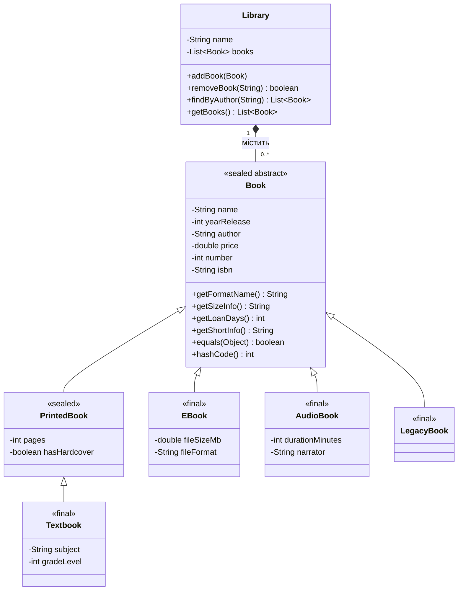

# Лабораторна робота 1 — Консольний застосунок з темою бібліотека (Книжка / Читач)

## Опис сутностей
- **Книжка**: назва, рік випуску, ціна
- **Читач**: ім'я, номер картки, номер телефону

## Обчислювальна операція
Якщо книжка видана 2007 року або раніше — ціна збільшується на 5%.

## Інструкція запуску

javac Main.java
java Main


## Лабораторна робота 2 — Масиви об'єктів (Книжка / Читач)

### Реалізовано
- Клас `Book` (назва, рік випуску, автор, рекомендований вік, ціна) з конструктором і `toString()`
- Клас `Reader` (ім'я, номер картки, телефон, рік народження) з конструктором і `toString()`
- Заповнення масивів `Book[]` та `Reader[]` через консоль (Scanner) у циклі
- Валідація вводу — захист від некоректних значень (рік, вік, ціна, кількість)
- Виведення масивів через for-each
- Підрахунок книжок дешевших за задану суму
- Сортування масиву книжок за ціною методом bubble sort (до/після сортування)
- Лінійний пошук книжки в масиві за повним збігом об'єкта (`equalsBook`)
- Розрахунок знижки 5% для книжок 2007 року видання і старших, з виведенням різниці цін

### Компіляція та запуск
```bash
javac *.java
java Main
```

## Лабораторна робота 3 — Обробка винятків

### Реалізовано
- Обробка стандартних винятків (`InputMismatchException`, `ArrayIndexOutOfBoundsException`, `ArithmeticException`) через конкретні catch-блоки
- `finally` для гарантованого закриття Scanner і фінального повідомлення
- Власний checked-виняток `DomainException` (базовий клас, extends Exception)
- Підкласи `InvalidPriceException` та `InvalidAgeException` з додатковим полем некоректного значення
- Валідація доменних правил безпосередньо в конструкторі `Book` (throw new ...)
- Множинні catch-блоки в одному try, впорядковані від специфічних типів до загальних
- Демонстрація re-throw: метод `createBook()` логує помилку і прокидає її далі
- Демонстрація поліморфізму винятків: один catch(DomainException) перехоплює обидва підтипи

### Компіляція та запуск
```bash
javac *.java
java Main
```

## Лабораторна робота 4 — Реалізація програмних інтерфейсів мовою Java

### Структура проєкту
```
task/java/
├── Main.java                      (головний клас, точка входу)
├── Class/
│   ├── Book.java                  (книга — поля, конструктор, toString, equals)
│   └── Reader.java                (читач — поля, конструктор, toString)
├── Exceptions/
│   ├── DomainException.java       (базовий checked-виняток домену)
│   ├── InvalidAgeException.java   (виняток невірного віку)
│   └── InvalidPriceException.java (виняток невірної ціни)
├── Interfaces/
│   ├── DiscountStrategy.java      (інтерфейс стратегії знижки з default-методом getDescription())
│   ├── RegularDiscount.java       (знижка 5% для книг 2007 року і старше)
│   ├── NewReleaseDiscount.java    (знижка 10% для новинок після 2007 року)
│   ├── FirstLetterMatchDiscount.java (підвищення ціни на 50%, якщо перша буква імені читача збігається з першою буквою назви книги)
│   └── Sortable.java              (інтерфейс сортування за ключем)
├── Abstract/
│   └── AbstractDiscountStrategy.java (абстрактний клас, імплементує DiscountStrategy частково: спільна валідація ціни та року)
└── Context/
    └── DiscountContext.java       (контекстний клас патерну Strategy — приймає стратегію через конструктор, має сетер для зміни в рантаймі, делегує виконання)
```

### Рівень 1 — Базовий (обов'язковий minimum)
- Визначено поведінку, яка відрізняється у різних сутностях: стратегія розрахунку знижки для книги.
- Описано цю поведінку у вигляді інтерфейсу `DiscountStrategy` з методом `applyDiscount(double price, int yearRelease)`.
- Реалізовано дві різні реалізації інтерфейсу: `RegularDiscount` та `NewReleaseDiscount`.
- Продемонстровано поліморфне використання: масив об'єктів типу `DiscountStrategy[]`, виклик методу у циклі, поведінка різна для різних реалізацій.

### Рівень 2 — Середній
- Додано `default`-метод `getDescription()` до інтерфейсу `DiscountStrategy` — успадковується усіма реалізаціями, може бути перевизначений.
- Створено абстрактний клас `AbstractDiscountStrategy`, що імплементує `DiscountStrategy` частково (задає спільну логіку валідації ціни та року, але не реалізує саму формулу знижки). Конкретні класи (`RegularDiscount`, `NewReleaseDiscount`) наслідують його.
- Клас `BookWithSort` реалізує кілька інтерфейсів одночасно: `DiscountStrategy` (бізнес-поведінка) та `Sortable` (сортування за ціною).
- Додано функцію: якщо перша буква імені читача співпадає з першою буквою назви книги — ціна піднімається на 50% (`FirstLetterMatchDiscount`).

### Рівень 3 — Високий (патерн Strategy)
- Створено контекстний клас `DiscountContext`, який приймає інтерфейс-стратегію через конструктор.
- Має сетер `setStrategy(DiscountStrategy)`, що дозволяє змінювати стратегію під час виконання програми (runtime), не створюючи новий об'єкт контексту.
- Метод `executeDiscount(double price, int yearRelease)` делегує виконання поточній стратегії.
- У `Main.java` продемонстровано зміну стратегії в рантаймі: `RegularDiscount` → `NewReleaseDiscount` → `FirstLetterMatchDiscount` на одній і тій ж книзі.

### Лабораторна робота 5 — Рефакторинг з патернами проєктування

#### Рівень 1 — Factory Method

**Проблема:** об'єкти стратегій знижок створювалися прямими викликами `new` у кількох місцях `Main.java`. Додавання нового типу знижки вимагало правки кожного такого місця.

**Рішення:** винесено логіку створення в клас-фабрику `Factory.DiscountFactory`:
- `createDiscount(String type)` — повертає `DiscountStrategy` за кодом типу (`REGULAR`, `NEW_RELEASE`, `FIRST_LETTER`).
- `createFirstLetterDiscount(String readerName)` — створює стратегію для конкретного читача.
- Усі прямий `new` у `Main.java` замінено на виклики фабрики.

Тепер додавання нового типу знижки вимагає правки лише в одному місці — у `DiscountFactory`.

#### Рівень 2 — Observer + JSON-логування

**Проблема:** зміна стану книги (ціни, кількості, статусу) повинна сповіщати інші частини системи (консольний лог, файл логів).

**Рішення:** реалізовано патерн Observer:
- Інтерфейс `Observer.LibraryObserver` з методом `update(String event, Object source)`.
- Клас-суб'єкт `Observer.LibrarySubject` зі списком підписників і методом `notifyObservers`.
- Два спостерігачі: `ConsoleLoggerObserver` (вивід у консоль) і `FileJsonLoggerObserver` (запис у JSON).
- Клас `Controller.LogController` керує записом у файл `Logs/LogJava.json`:
  - створює папку `Logs/` при потребі;
  - якщо файл `LogJava.json` вже існує — дописує нові записи;
  - кожен запис містить: `timestamp`, `event`, `bookName`, `oldPrice`, `newPrice`, `oldNumber`, `newNumber`, `oldStatus`, `newStatus`.

**Додаткові поля у `Book`:** `status` (В наявності / Закінчився), `number` (кількість екземплярів), `isbn`, `genre`, `publisher`, `rating` (0.0–5.0). Статус оновлюється автоматично при зміні кількості.

**Додаткові поля у `Reader`:** `email`, `registrationDate`, `isActive`.

**Валідація (клас `Exceptions.Validator`):**
- Телефон: має містити принаймні 7 цифр, дозволені символи `+`, `-`, `(`, `)`, пробіли.
- Email: має містити `@`, точку після `@`, не починатися ani не закінчуватися на `@` або `.`.

У `Main.java` додано цикли повторного введення для телефону та email, якщо формат невірний.

#### Рівень 3 — Adapter (Високий)

**Проблема:** у нас є ззовнішній/застарілий клас `Legacy.LegacyBookCatalog` із власними методами (`addLegacyBook`, `getLegacyCost`, `listAllLegacyTitles`), які не відповідають інтерфейсу, очікуваному нашим кодом (`BookCatalog`). Ми не можемо змінювати цей клас, бо це "зовнішня бібліотека".

**Рішення:** реалізовано патерн Adapter:
- Клас `Adapter.LegacyBookCatalogAdapter implements BookCatalog` огортає `LegacyBookCatalog` і перекладає виклики:
  - `addBook(Book)` → `addLegacyBook(title, year, cost)`
  - `getPrice(String)` → `getLegacyCost(String)`
  - `getAllBooks()` → перетворює `String[]` з `listAllLegacyTitles()` у `List<Book>`
- Сам `LegacyBookCatalog` не змінювався.

**Чому саме Adapter, а не переписування класу:**
- Клас належить сторонній бібліотеці — немає доступу до вихідного коду або це порушить інкапсуляцію.
- Переписування вимагало б змін у всіх місцях, де цей клас вже використовується зі своїм старим API.
- Адаптер дозволяє використовувати ззовнішній клас через зручний для нас інтерфейс без змін у самому класі.

#### Компіляція та запуск
```bash
javac Main.java Class/*.java Exceptions/*.java Abstract/*.java Interfaces/*.java Context/*.java Factory/*.java Observer/*.java Controller/*.java Legacy/*.java Adapter/*.java
java Main
```


### Рівень 3 — Високий

**equals/hashCode і симетрія.** `Book`, `PrintedBook`, `Textbook`, `EBook`, `AudioBook`
перевизначають `equals()` і `hashCode()`; кожен підклас порівнює свої нові поля після
`super.equals(...)`. Демонстрація (пункт меню 16):

| Вираз | `getClass()` (наш варіант) | `instanceof` (наївний варіант) |
|---|---|---|
| `base.equals(sub)` | `false` | `true` |
| `sub.equals(base)` | `false` | `false` |
| Симетрія | збережена | **порушена** |

Підхід `instanceof` у базовому класі вважає підклас «таким самим» об'єктом, а підклас, який
додав поле й вимагає його збігу, відповідає `false` у зворотний бік. Якщо ж підклас
пом'якшити й порівнювати лише базові поля з базовим об'єктом, зламається транзитивність
(`a.equals(b)`, `b.equals(c)`, але `!a.equals(c)`). Також порушується контракт `hashCode`:
рівні об'єкти мають різні хеші. Я обрав `getClass()`: підкласи додають стан, тому об'єкти
різних класів не повинні вважатися рівними, і всі властивості контракту виконуються. Ціна
такого вибору: порушується принцип підстановки Лісков для `equals` (екземпляр анонімного
підкласу не дорівнює екземпляру батька). Для кінцевих `final`-класів (`EBook`, `AudioBook`,
`Textbook`) обидва підходи еквівалентні. `hashCode` рахується лише за незмінними полями
(`name`, `yearRelease`, `author`, `isbn`, а в підкласах ще й їхні поля без сеттерів), бо
`price` і `number` мають сеттери: зміна ціни після вставки в `HashSet` загубила б об'єкт.

**Композиція замість наслідування.** Тут вона потрібна, бо хибно вважати, що бібліотека
*є* списком книг. Якби `Library extends ArrayList<Book>`, вона успадкувала б увесь API списку
(`add`, `addAll`, `add(index, ...)`, `set`, `remove`, `clear`, `sort`), і правило «ISBN
унікальний» неможливо було б утримати: у демонстрації (пункт 17) перевизначений `add(Book)`
відхиляє дублікат, але `addAll(...)` та `add(0, ...)` проходять повз перевірку, і в списку
опиняються три записи з одним ISBN. Крім цього:
- контракт `List` дозволяє дублікати, а наш підклас їх забороняє, тому `BrokenLibrary`
  не можна безпечно передати туди, де очікують звичайний `List<Book>` (порушення підстановки);
- публічний тип бібліотеки жорстко прив'язаний до `ArrayList`, і змінити реалізацію
  без поломки клієнтів неможливо;
- у бібліотеки є власна ідентичність (назва, правила), а не лише набір елементів.

`Library` містить приватний `List<Book>` і відкриває лише потрібні операції: `addBook`
(єдине місце перевірки), `removeBook`, `findByAuthor`, а `getBooks()` повертає
неізмінюваний перегляд.

**Діаграма класів.**



`getFormatName()` та `getSizeInfo()` у `Book` абстрактні, `getShortInfo()` фінальний.

**Запечатана ієрархія (sealed) і `switch`.** `Book` оголошено
`abstract sealed ... permits PrintedBook, EBook, AudioBook, LegacyBook`, `PrintedBook` —
`sealed ... permits Textbook`, решта підкласів `final`. Ланцюжок `if (x instanceof ...)` у
пункті меню 14 замінено на `switch` із pattern matching (`describeSpecific`) без гілки
`default`. Гарантія `sealed`: компілятор знає повний і закритий список прямих підкласів,
тому (1) `switch` без `default` перевіряється на вичерпність: якщо додати новий підклас у
`permits`, усі такі `switch` перестануть компілюватися, поки їх не оновлять, і пропущений
випадок виявляється на етапі компіляції, а не як помилка в роботі програми; (2) розширити
`Book` поза списком `permits` неможливо (помилка «class is not allowed to extend sealed
class»). Ще компілятор вимагає, щоб гілка підтипу (`Textbook`) стояла перед гілкою надтипу
(`PrintedBook`), інакше вона недосяжна (dominance). Ціна: підкласи мусять лежати в тому ж
пакеті, тому приватний `LegacyBook` з адаптера переїхав у пакет `Class`. Матеріали:
<https://docs.oracle.com/en/java/javase/21/language/sealed-classes-and-interfaces.html>


## Лабораторна робота 7-9 — типізований CRUD-сервіс

### Рівень 1

**BaseEntity.** Абстрактний клас із `long id` і `String name` (обидва `final`, гетери,
конструктор). Поле `id` не змінюється після створення. Id видає лічильник у `BaseEntity`
(`nextId()`), тому сутності отримують унікальні id автоматично; якщо валідація в конструкторі
`Book` не проходить, номер із лічильника втрачається, і це не заважає. Сутності `Book`
(з ієрархією `PrintedBook`, `EBook`, `AudioBook`, `Textbook`, `LegacyBook`) і `Reader`
успадковують `BaseEntity`. Поле `Reader.nameUser` замінено на `getName()`. `equals()` у `Book`
не бере до уваги `id`: порівнюються значення для пошуку за зразком (ЛР2), а не ідентичність
запису в сервісі.

**EntityNotFoundException — перевірений виняток (`extends Exception`).** Відсутність
сутності за id це очікувана, відновлювана ситуація (користувач ввів хибний id), а не
помилка програмування. Перевірений виняток змушує викликача явно її обробити: повідомити
користувача, запросити id ще раз. Це узгоджується з ЛР3, де доменні помилки теж перевірені.
Ціна: `throws` у сигнатурі й незручність у lambda/stream, але для рідкого виклику
`findById` вона прийнятна. Виняток зберігає `id` (`getId()`) і містить у повідомленні
назву сутності та id. Для `delete` виняток не потрібен: якщо запису вже немає, мету
видалення досягнуто, тому метод повертає `boolean` (`true`: запис існував і видалений).

**Навіщо `T extends BaseEntity`.** Сервісу потрібно ідентифікувати сутність: ключ у
`Map<Long, T>` це `entity.getId()`, і саме так `save` розрізняє «додати» й «оновити».
Без обмеження `T` вважається просто `Object`, у якого немає `getId()`: код
`m.put(entity.getId(), entity)` не компілюється з помилкою `cannot find symbol: method
getId()`. Обмеження також не дає створити сервіс для довільного типу (наприклад,
`CRUDService<String>`).

**InMemoryCrudService.** Один узагальнений клас без змін працює з `Book` і `Reader`
(`InMemoryCrudService<Book>`, `InMemoryCrudService<Reader>`); параметр конструктора лише
додає назву сутності в повідомлення. Сховище — `LinkedHashMap<Long, T>`: пошук за id за
O(1); повторний `save` з тим самим id замінює запис (кількість не зростає); порядок вставки
зберігається, і виведення передбачуване. Типізація перевіряється під час компіляції:
`bookService.save(reader)` не компілюється (`Reader cannot be converted to Book`).

**Демонстрація (пункт меню 18):** додавання, оновлення існуючого запису, успішний і
неуспішний `delete`, пошук неіснуючого id з обробкою винятку, та сама робота з `Reader`.


### Рівень 2

**Сортування за назвою: `Comparator`, а не `Comparable`.** `findAllSortedByName()` живе в
`InMemoryCrudService` (поле `name` є в `BaseEntity`, тому метод доступний будь-якому `T`).
Я вибрав `Comparator`, бо:
- `Comparable` задає один «природний» порядок усередині класу, а в сутностей його немає:
  `Book` можна впорядкувати за назвою, ціною, роком, а `Reader` за іменем чи роком народження;
- мені потрібні кілька порядків, які легко комбінуються й не вимагають змінювати класи
  сутностей: `Comparator.comparing(Book::getName, NAME_ORDER).thenComparingDouble(Book::getPrice)`;
- спосіб порівняння назв підставляється окремо: природний порядок `String` ставить великі літери
  перед малими, а `Є`, `І`, `Ї` перед `А` (перевірено: `[Intermezzo, Єва, Ємець, Іван, Їжак, Алгебра, ...]`),
  а `Collator` для `uk-UA` без урахування регістру дає український алфавітний порядок;
- `compareTo` за назвою в `BaseEntity` був би гіршим: порожній другий ключ, `compareTo == 0`
  для різних сутностей і неузгодженість з `equals` за `id`.

**Інтерфейс сутності й чому не в `CRUDService<T>`.** Метод
`findAllSortedByNameAndByPrice()` / `...ByYearOfBirth()` залежить від поля конкретної сутності:
друге поле сортування (ціна в `Book`, рік народження в `Reader`) існує лише в конкретному
класі, а в узагальненому `CRUDService<T>` компілятор знає про `T` тільки `id` і `name`.
Тому `BookService extends CRUDService<Book>` і `ReaderService extends CRUDService<Reader>`
додають метод сортування, а `InMemoryBookService extends InMemoryCrudService<Book> implements BookService`
успадковує сховище та CRUD і дописує лише сортування. Клієнт, якому потрібен лише CRUD,
залежить від `CRUDService<T>`.

**Методи сортування не змінюють сховище.** Вони беруть `findAll()` (нова `ArrayList`) і
сортують цю копію; порядок і склад `LinkedHashMap` не змінюються, а `sorted.clear()` не
торкається сховища. Копія неглибока: елементи ті самі об'єкти, тож зміна поля об'єкта
через відсортований список змінить його і в сховищі. Демонстрація: пункт меню 19, тестові дані містять
дві книги «Кобзар» (250 і 90 грн) і дві читачки «Катерина» (2003 і 1998).

**Вибір колекції для сховища.**

| Структура | `findById` | `save` (нова / оновлення) | `delete` | Відсортований за назвою список | Порядок обходу |
|---|---|---|---|---|---|
| `ArrayList<T>` | O(n), лінійний пошук | O(n): щоб відрізнити оновлення, треба знайти запис (додавання в кінець O(1) амортизовано) | O(n): пошук і зсув | O(n log n): копія й `sort` | порядок вставки |
| `HashMap<Long, T>` | O(1) у середньому | O(1) у середньому | O(1) у середньому | O(n log n): копія `values()` і `sort` | не визначений |
| `LinkedHashMap<Long, T>` | O(1) у середньому | O(1) у середньому | O(1) у середньому | O(n log n) | порядок вставки |
| `TreeMap<Long, T>` | O(log n) | O(log n) | O(log n) | O(n log n): обхід йде за `id`, не за назвою | за `id` |

Обрано `LinkedHashMap<Long, T>`: основні операції CRUD (`findById`, `save`, `delete`) виконуються
за O(1), повторний `save` з тим самим `id` заміняє запис, а порядок вставки робить вивід
передбачуваним і дає стабільне сортування «до/після». `ArrayList` програє на пошуку й видаленні за `id`.
`HashMap` так само швидкий, але порядок обходу не визначений. `TreeMap` тримає порядок за ключем,
тобто за `id`, а не за назвою, тож відсортований за назвою список усе одно будується окремо за
O(n log n). Дерево з порядком за назвою не підходить: назви не унікальні, а пошук був би не за `id`.
Сортування викликається рідше за CRUD, тому його ціна O(n log n) прийнятна.

**`equals()` і `hashCode()` за `id`.** У `BaseEntity` обидва методи визначені за `id` (і класом):
однаковий `id` означає той самий запис. `Reader` успадковує їх без змін. Ієрархія `Book`
свідомо лишає значеннєвий `equals` з ЛР6 (потрібен для пошуку за зразком, ЛР2, та демонстрації
симетрії); сервіс `equals` не використовує, бо ключ сховища це `id`.

**Чи узгоджений компаратор з `equals`.** Ні. `NAME_THEN_YEAR` (та `NAME_THEN_PRICE`) повертає 0
для різних сутностей з однаковою назвою й другим полем, хоча `equals` для них `false`
(різні `id`). Наслідок: у `TreeSet`/`TreeMap` з таким компаратором друга сутність вважалася б
дублікатом і була б загублена (у демонстрації 1 елемент замість 2, `HashSet` за `equals` дає 2). Тому ці
компаратори застосовуються лише для `List.sort`, який стабільний і нічого не відкидає. Щоб
зробити порядок узгодженим з `equals` за `id`, достатньо додати останнім ключем
`.thenComparingLong(BaseEntity::getId)`: тоді 0 повертається лише для однакового `id`
(у демонстрації 2 елементи). Для `Book` через значеннєвий `equals` узгодженості немає й так.


### Рівень 3

**`findAllSorted(Comparator<? super T>)` і `default findAllSortedByName()`.** У `CRUDService<T>`
додано метод `List<T> findAllSorted(Comparator<? super T> comparator)`; його реалізація в
`InMemoryCrudService` копіює значення сховища й сортує копію, тож це єдина точка сортування.
Обидва методи сортування реалізовано через неї: `findAllSortedByName()` (default-метод
інтерфейсу: назва є в кожного `T`, бо `BaseEntity` її містить, тому реалізація не дублюється в
класах і успадковується будь-яким майбутнім сервісом) та `findAllSortedByNameAndByPrice()` /
`findAllSortedByNameAndByYearOfBirth()` (`findAllSorted(NAME_THEN_PRICE)` та
`findAllSorted(NAME_THEN_YEAR)`).

**Чому `Comparator<? super T>`, а не `Comparator<T>`.** Компаратор лише *споживає* елементи
типу `T` (його метод `compare(T a, T b)` приймає їх на вхід), а споживачам відповідає
`? super T` (принцип PECS: producer extends, consumer super). Компаратор, що вміє порівнювати
будь-які `BaseEntity`, безперечно вміє порівнювати й дві `Book`, тож `Comparator<BaseEntity>` має
підходити для `CRUDService<Book>` та `CRUDService<Reader>`. З параметром `Comparator<T>` це не
працює (перевірено компілятором: `incompatible types: Comparator<BaseEntity> cannot be converted
to Comparator<Book>`), і довелося б писати окремий компаратор для кожної сутності навіть для
однакової логіки (за `id`, за назвою). У демо (пункт меню 20) один `Comparator<BaseEntity>`
сортує і книги, і читачів. Той самий підхід у `List.sort(Comparator<? super E>)` самого JDK.

**`printAll(Collection<? extends BaseEntity> items)`.** `List<Book>` не можна передати туди, де
очікується `List<BaseEntity>`: узагальнення в Java інваріантні, і `List<Book>` не є підтипом
`List<BaseEntity>`, хоча `Book` є підтипом `BaseEntity` (компілятор: `incompatible types:
List<Book> cannot be converted to List<BaseEntity>`). Інакше через посилання `List<BaseEntity>`
можна було б додати в список книг `Reader`, і наступне читання `Book b = books.get(i)` дало б
`ClassCastException`. (Масиви ковариантні й ловлять це лише під час виконання через
`ArrayStoreException`; узагальнення забороняють це ще на етапі компіляції.) Wildcard
`? extends BaseEntity` робить колекцію ковариантною лише для читання: усередині методу елементи
читаються як `BaseEntity`, а додавання заборонено (`items.add(reader)` не компілюється:
`Reader cannot be converted to CAP#1`), тому небезпечних дій зробити не вдається. Саме тому
`printAll` приймає `Collection<Book>`, `Set<Reader>` і `List<BaseEntity>` без змін. Параметр
саме `Collection`, а не `List`, бо метод лише обходить елементи. Варіант
`<E extends BaseEntity> void printAll(Collection<E>)` рівноцінний, але тип `E` більше ніде не
використовується, тому wildcard простіший.